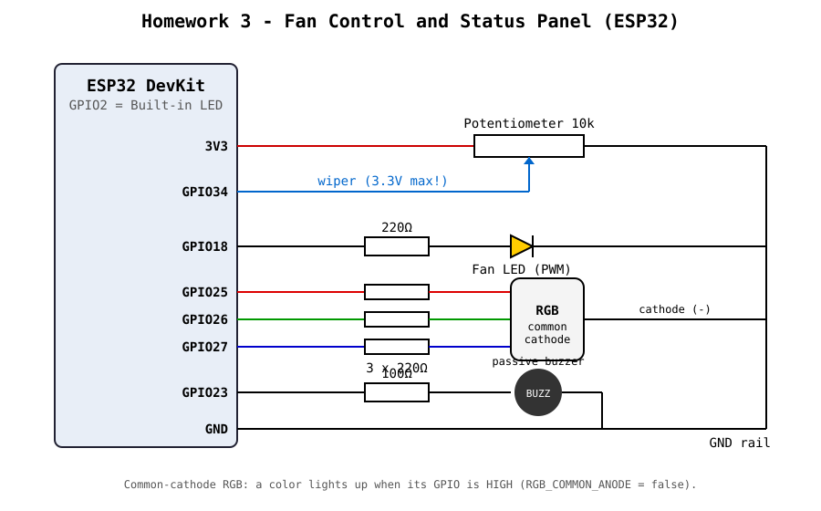
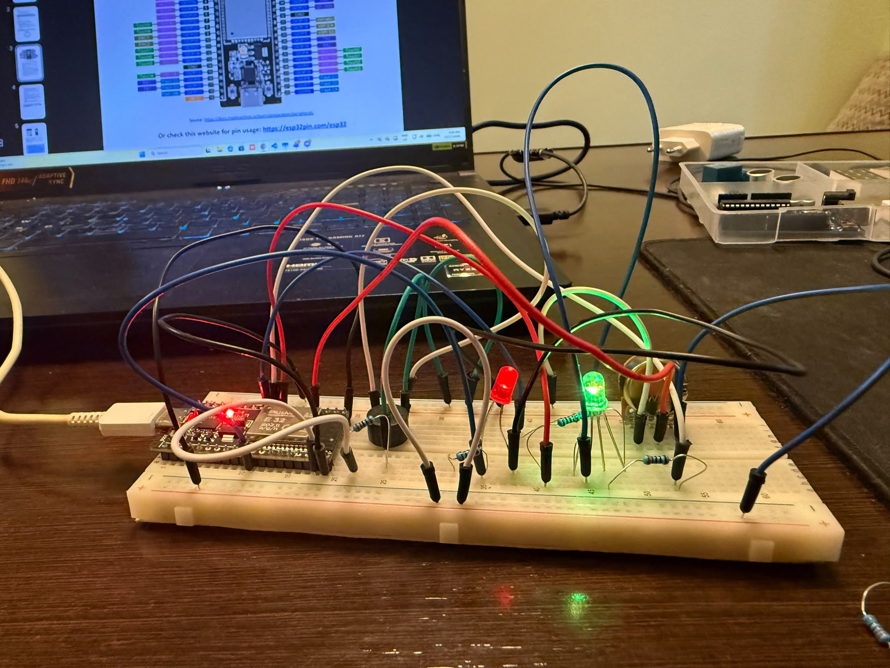
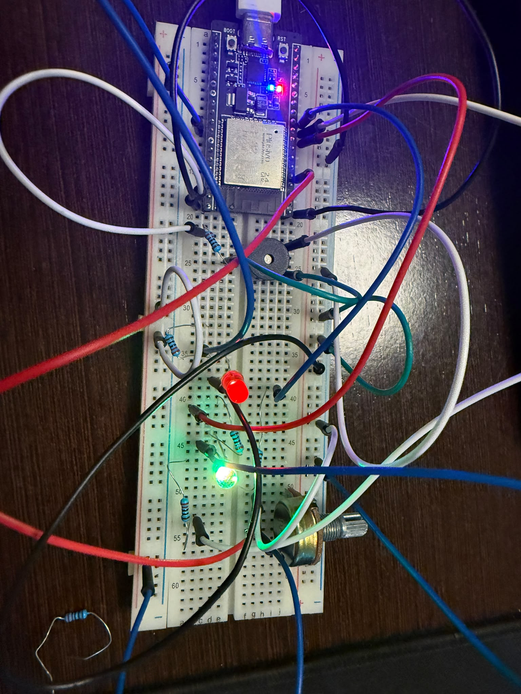
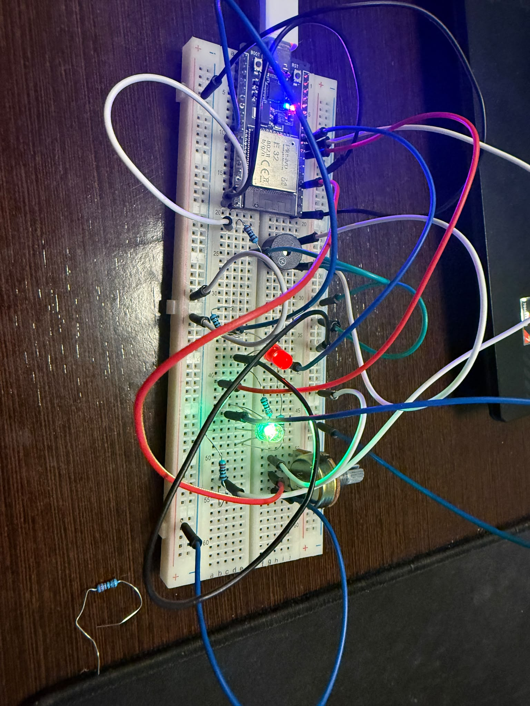

# Homework 3 - Fan Control and Status Panel

ESP32 project that simulates a fan control panel: a potentiometer sets the "fan speed" (the brightness of an LED), an RGB LED shows the operating level, a buzzer beeps when entering the high level, and the built-in LED blinks continuously as a system heartbeat.

## Hardware

| Component | ESP32 GPIO | Notes |
|---|---|---|
| Built-in LED (heartbeat) | GPIO2 | on the board |
| External LED (fan) | GPIO18 | 220Ω resistor, PWM |
| Potentiometer 10k | GPIO34 | ends on **3.3V** and GND, wiper on GPIO34 |
| RGB LED (R, G, B) | GPIO25, GPIO26, GPIO27 | 220Ω on each channel, **common cathode to GND** |
| Passive buzzer | GPIO23 | 100Ω in series, other pin to GND |

All components stay connected in a single circuit; no rewiring between tasks.

### Schematic



### Assembled circuit photos



| | |
|---|---|
|  |  |

## Functionality

1. **System Heartbeat** - the built-in LED (GPIO2) toggles every 500 ms using `millis()`, independently of everything else.
2. **Fan Speed Control** - the ADC reading (0-4095, 12 bit) is converted with `map()` into the PWM range 0-255 (8 bit) and written to the external LED via LEDC (5 kHz). Higher potentiometer position = brighter LED.
3. **RGB Status Indicator** - the ADC range is split into three equal parts:
   - `0 - 1364` -> **Blue** (low)
   - `1365 - 2729` -> **Yellow** (medium, red at full + green at reduced intensity)
   - `2730 - 4095` -> **Red** (high)
4. **Sound Notifications** - when entering the upper third, `tone(1000 Hz, 200 ms)` plays a short beep. The previous zone is stored (`lastZone`), so the sound plays only on the transition into the zone, not continuously.
5. **Non-blocking** - there is no `delay()` in `loop()`. Every periodic operation (heartbeat, serial) uses its own `millis()` timer, and `tone()` with a duration runs in the background on the ESP32.
6. **Serial Debugging** - every 500 ms at 115200 baud:
   ```
   ADC Raw: 3012 | ADC Smoothed: 2998 | PWM Output: 186 | Level: High (Red)
   ```

### Bonus

- **Smoothing** - the ADC reading goes through an exponential filter (`SMOOTHING = 0.15`) that reduces noise and LED brightness flicker.
- **Hysteresis** - the zone thresholds shift by ±80 depending on the current zone, so the RGB color does not flicker and the buzzer does not beep repeatedly when the potentiometer sits right at a threshold.

### Implementation notes

The RGB LED is driven with PWM (LEDC channels 2, 3, 4), not just on/off. The green diode is much brighter than the red one, so red + green at full power looks green; for yellow, green is reduced to `YELLOW_GREEN_LEVEL` (60/255).

The RGB LED is **common cathode**: the common pin goes to GND and a color lights up when its GPIO is set to `HIGH`. Each color has its own resistor (not one on the common pin, which would let red take all the current and green would no longer light up for yellow). The `setRgb()` function can invert the logic for a common-anode LED by setting `RGB_COMMON_ANODE = true`.

The PWM for the fan LED uses LEDC **channel 1**, not 0. On ESP32, `tone()` uses channel 0 by default and reconfigures it (frequency + 10-bit resolution), so sharing channel 0 would break the LED brightness after the first beep.

## Build & upload

PlatformIO project (`esp32dev`, Arduino framework, `espressif32@^6` = Arduino-ESP32 core 2.0.x).

```
pio run -t upload
pio device monitor
```

## Video demonstration

[Demo video](images/demo.mp4)
