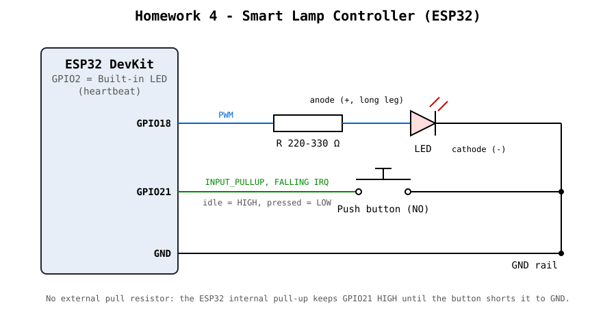

# Homework 4 - Smart Lamp Controller

ESP32 project that controls a "smart lamp" (an external LED) with a single push button. Short presses cycle through the lamp modes, a long press turns the lamp off, and the built-in LED blinks continuously as a system heartbeat. The button is detected with a GPIO interrupt and validated with software debouncing in the main loop.

## Hardware

| Component | ESP32 GPIO | Notes |
|---|---|---|
| Built-in LED (heartbeat) | GPIO2 | on the board |
| External LED (lamp) | GPIO18 | 220-330Ω resistor in series, PWM |
| Push button | GPIO21 | other leg to **GND**, internal pull-up (`INPUT_PULLUP`) |

The button needs no external resistor. GPIO21 idles `HIGH` through the internal pull-up, and pressing the button shorts it to GND (`LOW`). This produces a **falling edge** on press, which is what the interrupt listens for.

### Schematic



### Falstad simulation

[`falstad_circuit.txt`](falstad_circuit.txt) - import it in [Falstad Circuit Simulator](https://www.falstad.com/circuit/) with *File -> Import From Text*. Falstad has no ESP32, so the GPIO pins are modeled with equivalent components:

- **Left - lamp (GPIO18):** a 3.3 V source stands in for the GPIO18 output. A toggle switch acts as GPIO18 `HIGH`/`LOW` and feeds the 220Ω resistor and the LED to GND. Closed switch = `FULL`, open = `OFF`. PWM (`DIM`, `BLINK`) is the same switch toggled very fast.
- **Right - button (GPIO21):** a 3.3 V source and a 45 kΩ resistor model the ESP32 internal pull-up (about 45 kΩ typical). The node between the resistor and the push button is GPIO21. Hover over it: about 3.3 V (`HIGH`) at rest and 0 V (`LOW`) while the button is held. That HIGH-to-LOW transition is the falling edge that triggers the interrupt.

### Wiring steps

1. Place the ESP32 across the breadboard's center channel and connect a **GND** pin to the breadboard's GND rail.
2. **LED:** GPIO18 -> 220-330Ω resistor -> LED **long leg** (anode). LED **short leg** (cathode) -> GND rail.
3. **Button:** place it across the center channel. Connect one leg to **GPIO21** and the **diagonally opposite** leg to the GND rail. Diagonal legs always go through the switch contact.

## Functionality

### Checkpoint 1 - Operating modes

The lamp has four mandatory modes, changed by debounced short presses:

| Mode | LED output |
|---|---|
| `OFF` | PWM 0 |
| `DIM` | PWM 64 |
| `FULL` | PWM 255 |
| `BLINK` | 500 ms ON / 500 ms OFF |

Short press cycle: `OFF -> DIM -> FULL -> BLINK -> OFF` (extended by the bonus modes, see below).

### Checkpoint 2 - Independent, non-blocking operations

There is no `delay()` anywhere. `loop()` reads `millis()` once and passes it to independent update functions:

```cpp
void loop() {
  unsigned long now = millis();

  updateButton(now);
  updateClicks(now);
  updateLamp(now);
  updateHeartbeat(now);
}
```

- **Heartbeat:** the built-in LED (GPIO2) toggles every 500 ms, regardless of the lamp mode or the button.
- **Blink:** the lamp keeps its own timer (`lastBlinkToggle`). The heartbeat and the lamp never share timing state.
- Timers advance with `last += interval` instead of `last = now`, so they do not drift over time.
- PWM is written only when the duty cycle changes (`lastDuty`).

### Checkpoint 3 - Short and long presses

| Interaction | Result |
|---|---|
| Short press (released before 1000 ms) | next mode |
| Hold for 1000 ms | lamp turns `OFF` **immediately**, while still holding |
| Keep holding after the long press | no additional action |
| Release after a long press | no mode change |

The long press is detected while the button is still held (`now - pressStartTime >= longPressTime`). A `longPressHandled` flag makes sure it fires only once per press, and that the release that follows is ignored.

### Checkpoint 4 - Interrupt-assisted button handling

The interrupt only reports that *something may have happened*. It does not decide whether that was a short press, a long press or electrical noise.

```cpp
volatile bool buttonEventPending = false;
volatile unsigned long rawInterruptCount = 0;

void IRAM_ATTR onButtonISR() {
  buttonEventPending = true;
  rawInterruptCount = rawInterruptCount + 1;
}
```

- `attachInterrupt(digitalPinToInterrupt(21), onButtonISR, FALLING)`.
- The ISR is in IRAM, sets a flag and increments a counter. No `Serial`, no `millis()` logic, no application code.
- Shared variables are `volatile`, because they are written in the ISR and read in `loop()`.

The validation in `updateButton()` is a small state machine:

| State | What happens |
|---|---|
| `BTN_IDLE` | Waits for `buttonEventPending`. **No `digitalRead()` while idle.** |
| `BTN_VALIDATING_PRESS` | Polls the pin. A stable `LOW` for 30 ms confirms the press (`onConfirmedPress`). A stable `HIGH` means noise, so it goes back to idle. |
| `BTN_PRESSED` | Polls until a stable `HIGH` for 30 ms confirms the release (`onConfirmedRelease`). Also checks for the long press. |

Polling is used only during validation, which the assignment allows. When the button is released, the pending flag is cleared. This drops the extra falling edges that contact bounce produces on release, so they are not taken as a new press.

The input side (ISR + debouncing) is separate from the application actions (`onConfirmedPress`, `onConfirmedRelease`, `onShortPress`, `onLongPress`). Because of that, the lamp behaves exactly as it did in the polling-based version.

## Design decisions

- **Debouncing:** a level must be **stable** for `debounceDelay = 30 ms` before it is accepted. Each change in the reading restarts the timer (`lastChangeTime`). Bounce shorter than 30 ms is ignored, and a 30 ms delay is not noticeable to the user.
- **Interrupts:** the interrupt removes the need to poll the pin all the time. It only wakes the validation logic. All decisions stay in `loop()`, which keeps the ISR short and safe.
- **Non-blocking timing:** every periodic behavior (heartbeat, blink, breathing, SOS, double-click window, long press) uses its own `millis()` timestamp. The loop never waits, so the button stays responsive in every mode.

## Bonus

### A - Double click

Two short presses within **350 ms** of each other switch directly to `FULL`.

A single click cannot run immediately, because it might be the first half of a double click. So after a short press the code sets `singleClickPending` and waits:

- A second short press within 350 ms counts as a double click, and the lamp goes to `FULL`.
- If the 350 ms window expires, `updateClicks()` runs the single-click action (next mode).
- A long press cancels any pending click.

The cost is a 350 ms delay on single clicks, which the assignment explicitly allows.

### B - More operating modes

| Mode | Behavior |
|---|---|
| `BREATHE` | brightness fades up and down over a 3 s period (triangle wave with simple gamma correction, `duty = linear² / 255`, so it looks smoother to the eye) |
| `SOS` | `... --- ...` in Morse code: dot 200 ms, dash 600 ms, 600 ms between letters, 1400 ms between words. A pattern table is walked step by step with `millis()` |

With bonus modes enabled, the cycle is `OFF -> DIM -> FULL -> BLINK -> BREATHE -> SOS -> OFF`. Set `ENABLE_BONUS_MODES` to `0` to get the mandatory `BLINK -> OFF` cycle.

### C - Interrupt statistics

Each confirmed press prints both counters:

```
Press confirmat | intreruperi brute: 7 | apasari acceptate: 2
```

**Why the numbers differ:** a mechanical button does not switch cleanly. Its contacts bounce for a few milliseconds, producing several falling edges on a single press. More falling edges appear during the bounce on **release** (HIGH-LOW-HIGH). Electrical noise on the wire can also trigger spurious edges. The ISR counts every edge, while debouncing accepts only one press per real interaction. So the raw interrupt count is always greater than or equal to the accepted press count.

## Serial output

115200 baud. Example:

```
Mod lampa: OFF
Press confirmat | intreruperi brute: 3 | apasari acceptate: 1
Short press
Mod lampa: DIM
Press confirmat | intreruperi brute: 5 | apasari acceptate: 2
Long press -> OFF
Mod lampa: OFF
Release dupa long press (fara schimbare de mod)
```

## Build & upload

PlatformIO project (`esp32dev`, Arduino framework).

```
pio run -t upload
pio device monitor
```

## Video demonstration

[Demo video](images/demo.mp4)
