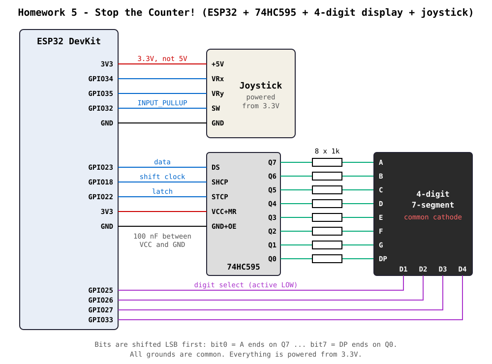
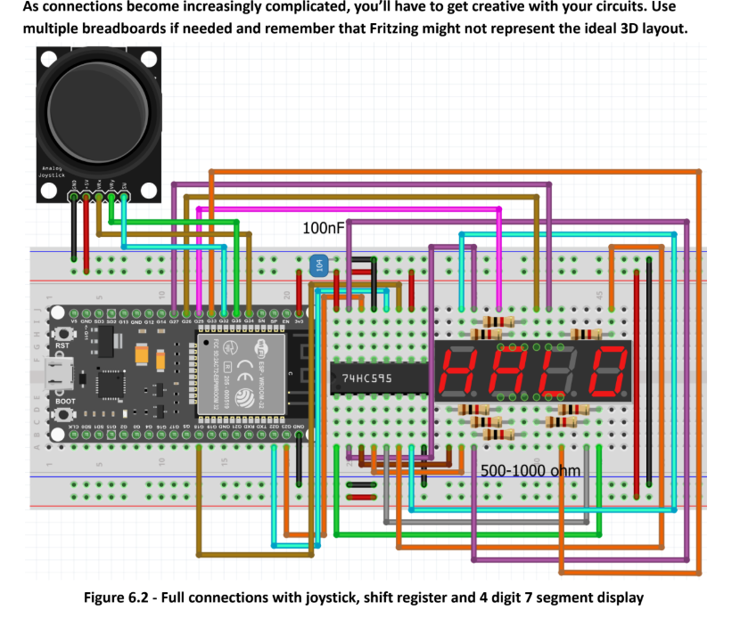

# Homework 5 - Stop the Counter!

Reaction game on an ESP32 with a 74HC595 shift register, a four-digit seven-segment display and a joystick. The display shows a target time. The player starts a countdown from a higher value and has to stop it as close to the target as possible. The error is `|stopped value - target|`; a perfect stop has an error of zero.

## Hardware

| Component / Signal | ESP32 GPIO | Notes |
|---|---|---|
| 74HC595 Data (DS) | GPIO23 | |
| 74HC595 Shift Clock (SHCP) | GPIO18 | |
| 74HC595 Latch (STCP) | GPIO22 | |
| Display digit select D1-D4 | GPIO25, 26, 27, 33 | common cathode, digit active on `LOW` |
| Joystick X axis (VRx) | GPIO34 | ADC, input only pin |
| Joystick Y axis (VRy) | GPIO35 | ADC, input only pin |
| Joystick button (SW) | GPIO32 | `INPUT_PULLUP`, pressed = `LOW` |

- The 74HC595 and the joystick are powered from **3.3V**, not 5V.
- 74HC595: `OE` to GND, `MR` to 3.3V, 100 nF capacitor between VCC and GND.
- Each segment has its own 1 kΩ resistor between the shift register output and the display.
- Shift register outputs: `Q7..Q0` drive segments `A, B, C, D, E, F, G, DP`.

The whole project uses one fixed circuit, the same one as in Laboratory 4.

### Schematic



### Wiring diagram

Breadboard layout from Laboratory 4 (Figure 6.2):



### Assembled circuit


## Controls

| Input | Before start (target visible) | While counting | After stop |
|---|---|---|---|
| Joystick **UP** | start the countdown | - | - |
| Joystick **button (SW)** | - | **stop** the countdown | - |
| Joystick **DOWN** | new random target | abort, back to the same target | **reset**: new round |
| Joystick **LEFT / RIGHT** | change difficulty level | - | cycle what the display shows |

After a stop, LEFT / RIGHT cycle through four screens. A short text names each screen before its value appears:

| Text | Value |
|---|---|
| `StOP` | the stopped value (shown by default, frozen) |
| `Err` | the error |
| `GOAL` | the target |
| `bESt` | the best (smallest) error on the current level, `----` if there is none yet |

## How the game works

1. **Target and initial state** - at startup the display shows a random target. It stays visible until the player starts.
2. **Countdown** - UP starts the countdown from a start value above the target. The start value is picked so that the countdown reaches the target after 4 to 8 real seconds. If the player does nothing, the countdown stops by itself at zero.
3. **Stop and score** - the button freezes the display at the current value. The Serial Monitor (115200 baud) prints the target, the stopped value and the error:
   ```
   [STOP] Target: 7.12 | Stopped: 7.05 | Error: 0.07
   ```
4. **Reset** - DOWN returns to the initial state with a new target.

### Countdown logic

Values are stored as integers in centiseconds (`913` = 9.13 s). The current value is computed from elapsed time, it is not decremented step by step:

```
value = start - (millis() - startMs) * speed / 10
```

So the countdown stays exact even if a `loop()` pass takes longer, and no timer has to be kept in sync.

### Leading zeros

`showNumber()` blanks leading digit positions with an empty segment pattern (`0`). In time format the seconds digit and the two hundredths digits are always visible:

| Value | Display |
|---|---|
| 1234 | `12.34` |
| 913 | `9.13` (not `09.13`) |
| 42 | `0.42` |
| 0 | `0.00` |

Setting `TIME_FORMAT = false` in `main.cpp` switches to plain integers. Then `9` is shown as `9`, `42` as `42` and zero as a single `0`.

## Bitwise display control

- Every character is one `uint8_t` segment mask: bit0 = A, bit1 = B, ... bit6 = G, bit7 = DP.
- Letters are built by OR-ing segment bits, for example `CH_L = SEG_D | SEG_E | SEG_F`.
- The decimal point is added with `displayBuffers[DP_DIGIT] |= SEG_DP`, which touches only the DP bit.
- `writeSegments()` sends the byte to the 74HC595 bit by bit with `(mask >> i) & 1`. A common anode display only needs the mask inverted with `~mask`.
- Blinking uses a 4-bit mask (`blinkDigits`, one bit per digit). A blinking digit is cleared with `mask &= blinkKeepMask`, so in Hacker Mode the digit goes dark while its decimal point stays lit.
- The digit index wraps with `& 0b11` instead of a modulo.

No seven-segment library is used.

## Non-blocking implementation

There is no `delay()` and no waiting loop anywhere. `loop()` runs three steps continuously:

1. `handleInput()` - joystick, button and game state machine
2. `render()` - decides which four segment masks are shown
3. `refreshDisplay()` - multiplexing: every 2 ms (`micros()`) the current digit is turned off, the next mask is shifted out and the next digit is turned on. The whole display refreshes at 125 Hz, during the countdown too.

Input handling:

- **Dead zone and edge detection** - a direction is reported once, when the stick moves more than 900 ADC units away from the center. The next direction is accepted only after the stick returns within 450 units of the center (hysteresis). Holding the stick does not repeat the action. The thresholds come from measurements on my module: it rests around 2000, reaches 4095 at one end but only about 500-700 at the other.
- **Noise filtering** - a direction has to stay the same for 3 consecutive readings (30 ms) before it is accepted. If both axes are deflected at the same time (the smaller deflection is more than half of the larger one), the reading is ignored: that is a loose power or ground contact on the joystick, or an unclear diagonal, not a command.
- **Serial debugging** - every accepted direction is printed with the raw ADC values, for example `[JOY] SUS (x=4095 y=1990)`, and ignored readings are printed as `[JOY] ignorat`.
- **Center calibration** - the center is measured at startup, because it differs between joystick modules. If the measured value is far from mid-scale (the stick was held tilted during power-up), the nominal center of 2000 is used instead.
- **Orientation** - the module sits on the breadboard rotated, so VRx is the vertical axis. `JOY_SWAP_AXES`, `JOY_INVERT_X` and `JOY_INVERT_Y` in `main.cpp` map the raw axes to up / down / left / right.
- **Button debouncing** - a press is accepted after the level stays stable for 30 ms. The stop value is computed for the moment of the first contact, not for the moment the debounce ends, so debouncing does not add 30 ms to the score.
- Directions are ignored while the button is held. Pressing the stick also tilts it slightly, and a stop should not turn into a reset.

## Bonus features

- **Time-based display with decimal point** - values are seconds with hundredths (`9.13`), stored as centiseconds.
- **Random targets** - every round gets a new target from `esp_random()`. The start value keeps the round playable (4 to 8 seconds to the target).
- **Difficulty levels** - LEFT / RIGHT before the start. The display shows `L 1`, `L 2` or `L 3`.

  | Level | Speed | Target range |
  |---|---|---|
  | 1 | real time | 1.00 - 9.99 |
  | 2 | 2x | 2.00 - 19.99 |
  | 3 | 3x | 3.00 - 29.99 |

- **High scores** - the smallest error is remembered for each level (until reset of the board) and shown on the `bESt` screen.
- **Display effects** - the result blinks when it is a new record, text labels (`StOP`, `Err`, `GOAL`, `bESt`, `L n`), and the numerical error is shown directly on the display.
- **Hacker Mode** - see below.

### Hacker Mode (secret)

After a stop, move the joystick **UP, UP, LEFT, RIGHT**. The stopped value becomes editable:

| Input | Action |
|---|---|
| LEFT / RIGHT | select one of the four digits |
| UP / DOWN | increase / decrease the selected digit |
| Button | confirm the edited result |

Visual cue: **all four decimal points are lit** and the **selected digit blinks**. All four digits are shown in this mode, including leading zeros, so every position can be selected.

On confirm the error is recalculated from the edited value, printed to the Serial Monitor with the `[HACKED]` tag, and it can also become the new best score. The sequence is checked by a small matcher (`advanceSecret()`); moves that belong to the sequence do not trigger their normal action.

## Build & upload

PlatformIO project (`esp32dev`, Arduino framework).

```
pio run -t upload
pio device monitor
```

## Video demonstration

[Demo video](images/demo.mp4)
